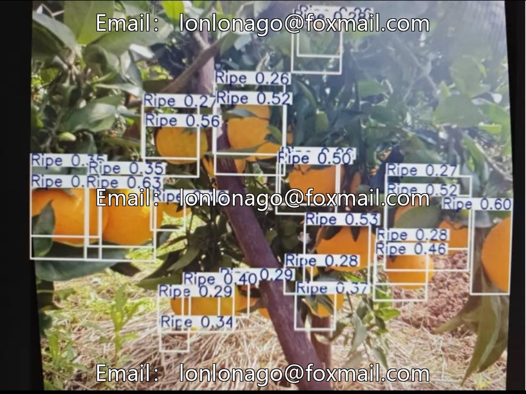
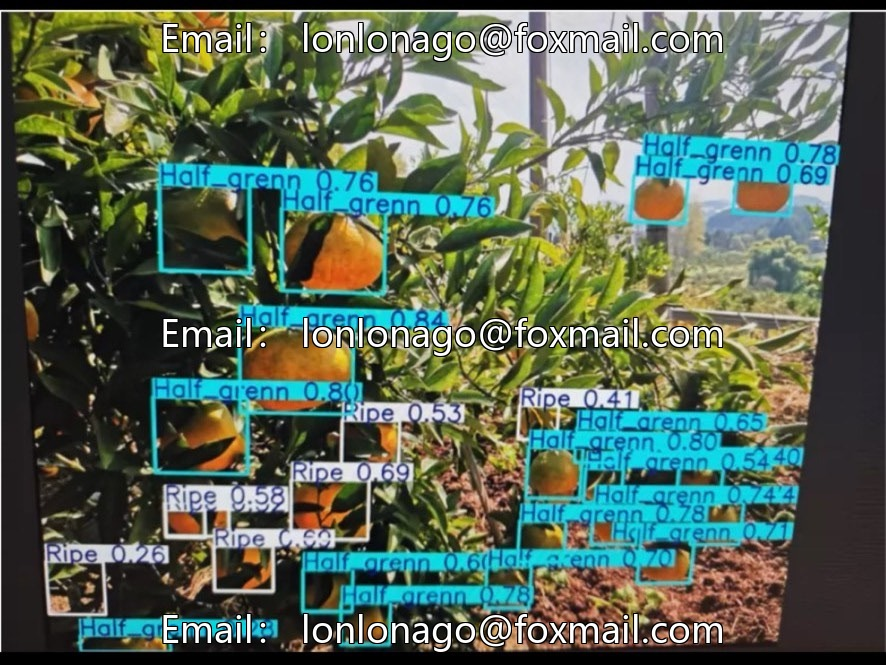
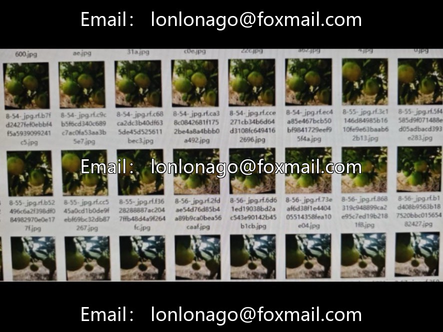
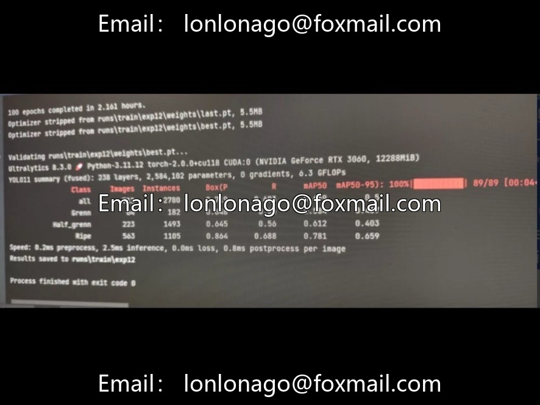

# Complex environment citrus maturity detection dataset, 7327 images, 3 categories of maturity levels

## Body

Complex Environment Citrus Maturity Detection Dataset, comprising 7327 images, categorized into three maturity levels (unripe, semi-ripe, ripe), annotated in YOLO format, suitable for scenarios such as smart agriculture, precise harvesting, and yield estimation.
Recommend using the YOLOv8m or l version to enhance color detail recognition capabilities.
The dataset includes complex backgrounds (branch obstruction, lighting changes, multiple angle shots), with clear annotations, directly applicable for model training and testing.

Virtual materials, once sold, are non-refundable.
Interested friends, click "I want" to proceed.

## Images

## Payment

Here is a pay link on Stripe ( https://buy.stripe.com/3cs8yP7sY87d0vu9AB ). Please contact me lonlonago@foxmail.com after funding $89, and I will send you a complete data files , thank you!

